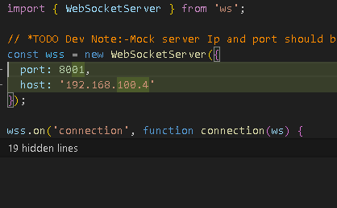
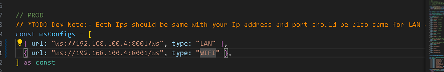
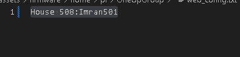

# Python Script Setup Guide

**Important:**
When testing, make sure this directory exists by updating the following line in the script::
## For Window:
```python
PATH_PROGRAM_DIRECTORY = "home/pi/OneUpGroup"
```
## For Raspberry Pi :
```python
PATH_PROGRAM_DIRECTORY = "/home/pi/OneUpGroup"
```

This guide provides instructions to set up the development environment for the firmware.

## Prerequisites
- Python 3 must be installed.
- `apt` package manager available (typically on Debian-based systems).

## Setup Steps

### 1. Move to the Firmware Directory

Navigate to the firmware project directory:

```bash
cd /path/to/python script
```

### 2. Create and Activate a Virtual Environment

Create a virtual environment named `myenv`:

```bash
python3 -m venv myenv
```

Activate the virtual environment:

```bash
source myenv/bin/activate
```

### 3. Install Required Python Packages

Install the necessary Python libraries inside the virtual environment:

```bash
pip install websockets
pip install Pillow
pip install qrcode[pil]
```

### 4. Run Script:

Run the python script:
```bash
python pythonScript.py
```


For Mock Server Connection Steps:-


First Need to change ip address and port according to your network in mockServer.mjs, as mentioned in above image


Secondly you need to change and add same ip address for both Lan and Wan in connectionStore as you have added in mockServer.mjs

So basically you need to add same ip address and port in mockServer.mjs and connectionStore file


You need to add the Wi-Fi name and password in the web_config, using the same credentials as the network you are currently connected to.


Then after above steps we need to first run mock server command
yarn run mock-server

and then run app