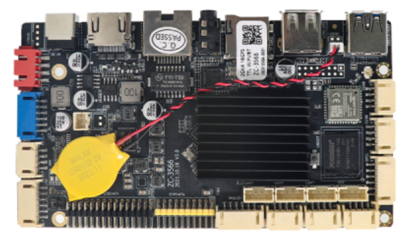
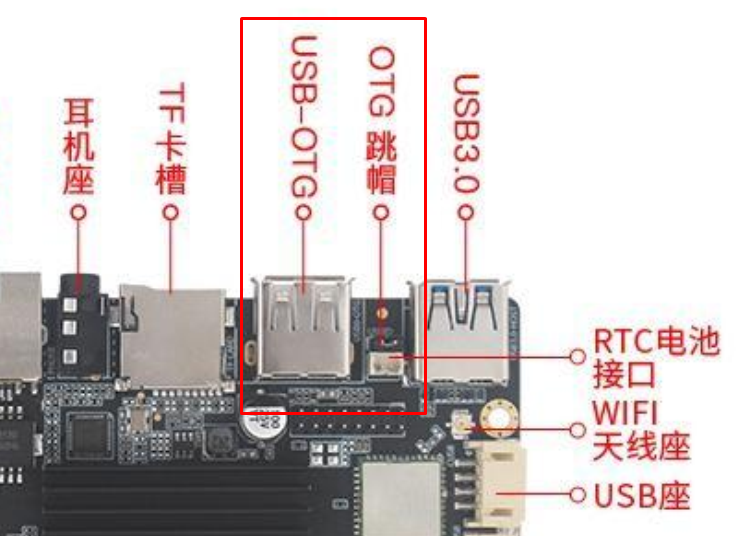

# OneUpGroup RK3566 Linux Setup Guide

This guide explains how to:

- Flash a Debian-based Linux image onto an RK3566 development board
- Deploy project files
- Set up a custom Python GUI script to run at boot



## 📁 Folder Structure
```
Readme.md
files/      (readme.md assets)
DriverAssitant_v5.1.1.zip/
    ├── config.ini
    ├── DriverInstall.exe
    ├── Readme.txt
    ├── ADBDriver/
    ├── Log/
    ├── bin/
    └── Driver/
RKDevTool_Release_v2.86.zip/
    ├── config.ini
    ├── config.cfg
    ├── revision.txt
    ├── RKDevTool.exe
    ├── Readme.txt
    ├── Language/
    ├── Log/
    ├── bin/
    └── Output/
project.zip/
    ├── setupScript.sh
    └── OneUpGroup/
        ├── pythonScript.py
        ├── NextTime_just_logo.png
        └── web_config.txt
```

## 🛠️ Step 1: Flash Debian Image to RK3566 Board

1. **Install DriverAssistant**.

    - On Windows:

        1. Download **[DriverAssistant](https://github.com/rockchip-linux/tools/raw/master/DriverAssitant/DriverInstall.exe)**
        2. If you're using a **Windows PC** to flash the image
        3. Run `DriverInstall.exe` as Administrator.
        4. Click **Install Driver**.
        5. Once done, connect your RK3566 board via USB and ensure it's detected in **Loader mode**.

    > If the device isn't detected, hold the recovery (maskrom) button and then plug in USB.

    - On Linux:
        1. Clone the DriverAssistant repo:
            ```bash
            git clone https://github.com/rockchip-linux/rkbin.git
            cd rkbin/tools/Linux_Upgrade_Tool
            ```

        2. Install USB permissions for Rockchip devices:
            ```bash
            sudo cp 99-rockchip.rules /etc/udev/rules.d/
            sudo udevadm control --reload-rules
            sudo udevadm trigger
            ```

        3. Grant USB device access:
            ```bash
            sudo chmod a+rw /dev/bus/usb/*/*
            ```

        4. Replug the RK3566 board and confirm detection using:
            ```bash
            lsusb
            ```

2. **Install rkDevTool [(source)](https://github.com/rockchip-linux/rkdeveloptool)**:
    - On Windows:
        1. Download [rkDevTool](https://drive.google.com/drive/folders/1xt8wAP21TPyT5A3dhSoWf9o8JMyka0Zg).
        2. Navigate to rkDevTool directory and modify config.ini file.
            > Change lang1File parameter to "English.ini"

    - On Linux:  
        ```bash
        sudo apt install libudev-dev libusb-1.0-0-dev git make gcc
        git clone https://github.com/rockchip-linux/rkdeveloptool.git
        cd rkdeveloptool
        make
        sudo cp rkdeveloptool /usr/local/bin/
        ```

3. **Put your RK3566 board into Loader mode** (usually via pressing maskrom button + USB-OTG).
    
    

4. **Flash Debian image**:

    > Linux Image can be downloaded from [source (link expiry 2025-06-26)](https://t.xmdlplus.com/fileRead/download?s=uvx26InU7%2FhcYjiyr0P2Hupdt5%2F9KvyhFGBWqa%2Fc0UwNJRKspTMqz5vE1CeZRz2YdJ6X0vlInwfYADnVAPooWuA05n78DBBIGz2MH0GR6AE%3D)

    - On Windows:
        1. Open rkDevTool and navigate to "Update Firmware" tab.
        2. Click "Firmware" button and select linux image.
        3. Click "Upgrade" button to start flashing the image on dev board.

    - On Linux:
        ```bash
        sudo rkdeveloptool db rk356x_loader_xxx.bin
        sudo rkdeveloptool wl 0x0 path/to/debian-image.img
        sudo rkdeveloptool rd
        ```


## 📂 Step 2: Copy Files to Target System

1. **Transfer `project-root/` folder** to the RK3566 system (use SCP, USB, or SD card):
    ```bash
    scp -r project-root/ linaro@<rk3566-ip-address>:/home/linaro/
    ```

2. **Log into your RK3566 device**:
    ```bash
    ssh linaro@<rk3566-ip-address>
    ```


## 🔐 Step 3: Change Script Permissions
On dev board, change 
```bash
cd /home/linaro/project-root
chmod +x setup_OneUpGroup.sh
sudo ./setup_OneUpGroup.sh
```

## 🔐 Step 4: Run Script

On Dev Board, Navigate to the folder containing setup script and run the script.

```bash
sudo ./setup_OneUpGroup.sh
```

This will install required packages to run the OneUpGroup GUI script and sets up service to start oneupgroup service at system startup
